# Prompt-to-Prompt (P2P)

This is a PyTorch reproduction of **Prompt-to-Prompt Image Editing with Cross Attention Control** by Hertz et al. (ICLR 2023).
It uses the pretrained [LDM text-to-image model](https://huggingface.co/CompVis/ldm-text2im-large-256) (256 &times; 256) and implements the word swap edit:

1. Generate the first prompt (the source) and keep its cross-attention maps of all 16 U-Net layers at every DDIM step.
2. Align the tokens of the source and each other prompt word by word, because one word can split into a different number of tokens (`lemon` is 1 token, `pistachio` is 3).
3. Generate each other prompt from the same seed. In the first n steps, replace its cross-attention maps with the aligned source maps.

Use `--inject-steps` to set n at test time; no training is necessary. With `--eta 0`, the results are deterministic for a given seed.

## Examples

All images use seed `42`, 50 DDIM steps and guidance `5.0`. The source prompt is *lemon cake.*

<table align="center">
  <tr>
    <th width="100%">No injection (<code>--inject-steps 0</code>)</th>
  </tr>
  <tr>
    <td align="center">
      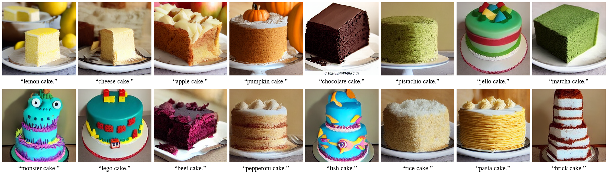<br>
      <sub>Each prompt makes its own plate, background and cake shape.</sub>
    </td>
  </tr>
  <tr>
    <th width="100%">Injection in the first 20 steps (<code>--inject-steps 20</code>)</th>
  </tr>
  <tr>
    <td align="center">
      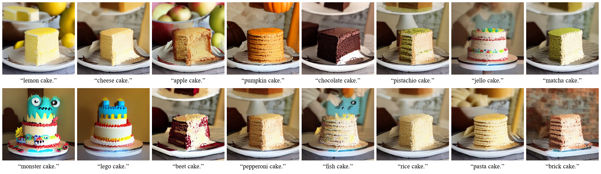<br>
      <sub>Most prompts keep the layout of <i>lemon cake.</i> and change the cake.</sub>
    </td>
  </tr>
</table>

## Installation

1. Make a Python environment:

   ```bash
   conda create -n p2p python=3.12
   conda activate p2p
   ```

2. Install [PyTorch](https://pytorch.org/get-started/locally/) for your CUDA version. This repository was tested with PyTorch `2.14.0` and CUDA `13.2`.

3. Install the other packages:

   ```bash
   pip install -r requirements.txt
   ```

4. Download the checkpoint (6.15 GB) to `models/ldm-text2im-large-256/`:

   ```bash
   python -m scripts.download_model
   ```

## Usage

Generate the 16 cake prompts with the default settings:

```bash
python generate.py
```

The grid goes to `outputs/cakes-seed42-inject20.png`, and the single images go to `outputs/cakes-seed42-inject20/`.
To use other prompts, edit the `prompts` list in `main()` of `generate.py`.
The first prompt is the source. All prompts must have the same number of words (separated by spaces).

Use `--inject-steps` to set how many of the first DDIM steps use the source maps:

```bash
python generate.py --inject-steps 10
```

<table align="center">
  <tr>
    <th width="10%"></th>
    <th width="15%"><code>0</code></th>
    <th width="15%"><code>10</code></th>
    <th width="15%"><code>20</code></th>
    <th width="15%"><code>30</code></th>
    <th width="15%"><code>40</code></th>
    <th width="15%"><code>50</code></th>
  </tr>
  <tr>
    <td align="center"><sub><i>apple cake.</i></sub></td>
    <td align="center">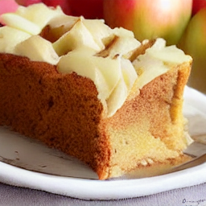</td>
    <td align="center">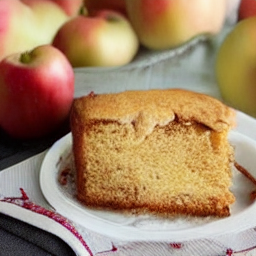</td>
    <td align="center">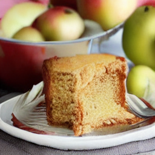</td>
    <td align="center">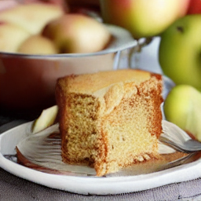</td>
    <td align="center">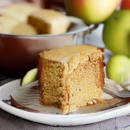</td>
    <td align="center"></td>
  </tr>
  <tr>
    <td align="center"><sub><i>chocolate cake.</i></sub></td>
    <td align="center">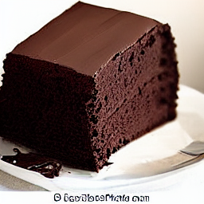</td>
    <td align="center">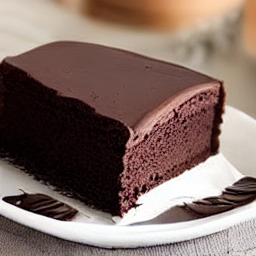</td>
    <td align="center">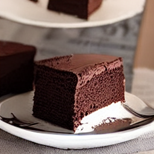</td>
    <td align="center">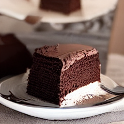</td>
    <td align="center">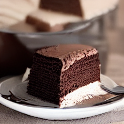</td>
    <td align="center">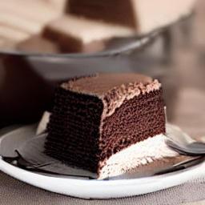</td>
  </tr>
  <tr>
    <td align="center"><sub><i>pistachio cake.</i></sub></td>
    <td align="center">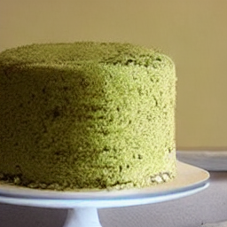</td>
    <td align="center">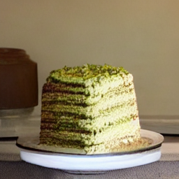</td>
    <td align="center">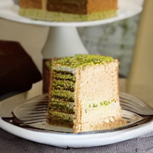</td>
    <td align="center">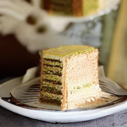</td>
    <td align="center">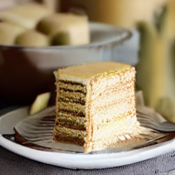</td>
    <td align="center">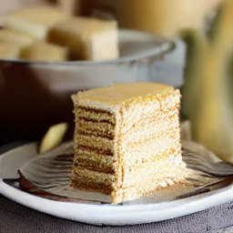</td>
  </tr>
  <tr>
    <td align="center"><sub><i>monster cake.</i></sub></td>
    <td align="center">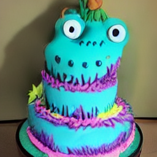</td>
    <td align="center">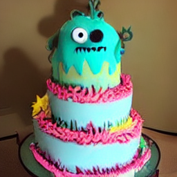</td>
    <td align="center">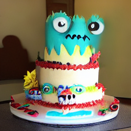</td>
    <td align="center">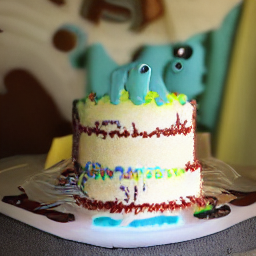</td>
    <td align="center">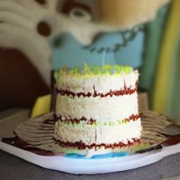</td>
    <td align="center">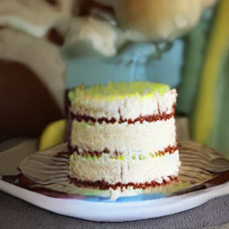</td>
  </tr>
</table>

- Use `0` to turn off the injection. Each prompt then makes its own layout.
- Use `10` to `20` to keep the plate and the cake position of the source and still change the cake. Start with `20`.
- Use `30` to `50` to keep the source layout closely. The new word then changes mostly the color of the cake.
- Use a smaller value for words that change the shape of the cake (*monster*, *lego*).

## Options

| Argument | Type | Default | Description |
|:---:|:---:|:---:|:---:|
| `--steps` | integer | `50` | Number of DDIM steps, from `1` to `999`. |
| `--guidance` | float | `5.0` | Classifier-free guidance scale. |
| `--eta` | float | `0.0` | DDIM noise. `0` is deterministic and `1` is similar to DDPM. |
| `--seed` | integer | `42` | Random seed. All prompts use the same initial noise, and the same noise at each step when `--eta` is above `0`. |
| `--batch-size` | integer | `8` | Number of prompts that are sampled together. |
| `--inject-steps` | integer | `20` | Number of first DDIM steps that use the cross-attention maps of the first prompt, from `0` to `--steps`. `0` turns off the injection. |
| `--width` | integer | `256` | Image width in pixels. It must be a multiple of `64`. |
| `--height` | integer | `256` | Image height in pixels. It must be a multiple of `64`. |
| `--device` | string | `auto` | `auto`, `cpu`, `mps`, `cuda` or `cuda:N`. `auto` uses CUDA, then MPS, then the CPU. |
| `--dtype` | string | `auto` | `auto`, `float32`, `float16` or `bfloat16`. `auto` uses `float32`. |
| `--output` | path | `-` | Path of the grid PNG. The default is `outputs/cakes-seed<seed>-inject<n>.png`. |
| `-h`, `--help` | flag | `-` | Show the help message and exit. |

## Project Structure

```text
Prompt2Prompt/
├── assets/
│   └── readme/                    # Images for this README
├── models/                        # Model definitions
│   ├── autoencoder.py             # KL autoencoder (latent to image)
│   ├── bert.py                    # LDMBert text encoder
│   ├── layers.py                  # Shared layers: ResNet block, attention
│   ├── scheduler.py               # DDIM sampler
│   ├── unet.py                    # Conditional U-Net with cross-attention hooks
│   ├── model_manifest.json        # File names, sizes and SHA-256 of the checkpoint
│   └── ldm-text2im-large-256/     # Checkpoint (not in git)
├── outputs/                       # Generated images (not in git)
├── scripts/
│   └── download_model.py          # Checkpoint download
├── utils/
│   ├── align.py                   # Word-by-word token alignment of two prompts
│   ├── config.py                  # Paths and constants
│   ├── device.py                  # Device and dtype choice
│   ├── image.py                   # Tensor to PIL image, captioned grid
│   └── loader.py                  # Config and weight loading
├── generate.py                    # Prompts, sampling loop, attention injection
├── requirements.txt
└── LICENSE
```

## Reference

```bibtex
@inproceedings{hertz2023prompttoprompt,
  title     = {Prompt-to-Prompt Image Editing with Cross Attention Control},
  author    = {Hertz, Amir and Mokady, Ron and Tenenbaum, Jay and Aberman, Kfir and Pritch, Yael and Cohen-Or, Daniel},
  booktitle = {International Conference on Learning Representations (ICLR)},
  year      = {2023}
}

@inproceedings{rombach2022high,
  title     = {High-Resolution Image Synthesis with Latent Diffusion Models},
  author    = {Rombach, Robin and Blattmann, Andreas and Lorenz, Dominik and Esser, Patrick and Ommer, Bj{\"o}rn},
  booktitle = {IEEE/CVF Conference on Computer Vision and Pattern Recognition (CVPR)},
  pages     = {10684--10695},
  year      = {2022}
}
```

Papers: [Prompt-to-Prompt](https://arxiv.org/abs/2208.01626), [Latent Diffusion Models](https://arxiv.org/abs/2112.10752).

## License

This project is released under the [MIT License](LICENSE).
